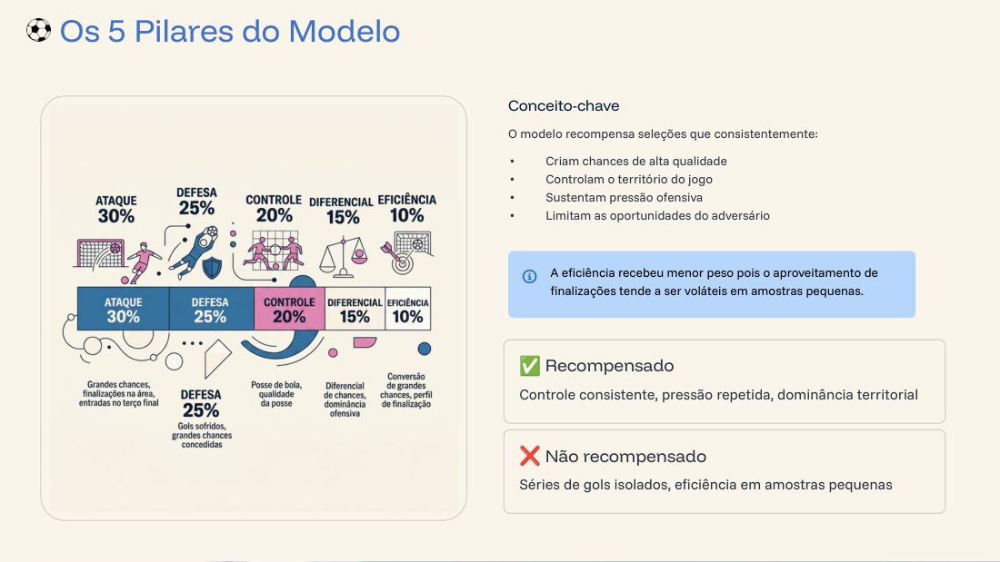
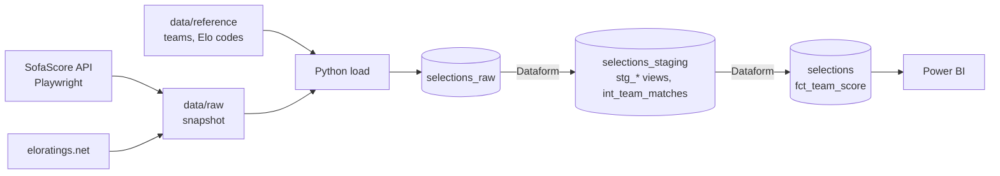

# ⚽ Beyond FIFA Rankings

**Which national teams were actually playing at the highest level going into the 2026 World Cup?**

This project ranks 29 national teams by *how* they play, not by results. It uses their last 20 matches, weights each match by the opponent's strength (World Football Elo Ratings) and combines five pillars into one score: attack, defense, control, differential and efficiency.

Stack: **Python + Playwright** (collection) → **BigQuery** → **Dataform** (modeling and tests) → **Power BI**.



## Result

| # | Team | Score | Attack | Defense | Control | Differential | Efficiency |
|---|---|---|---|---|---|---|---|
| 1 | Spain | 58.39 | 1.93 | 0.08 | 1.19 | 2.02 | 0.60 |
| 2 | England | 57.92 | 1.08 | 1.49 | 1.72 | 0.89 | -0.42 |
| 3 | Germany | 57.45 | 1.74 | 0.35 | 1.23 | 1.14 | 0.40 |
| 4 | Morocco | 55.46 | 0.76 | 1.04 | 0.28 | 1.25 | 0.50 |
| 5 | Portugal | 54.43 | 1.15 | -0.03 | 1.24 | 0.59 | -0.40 |
| 6 | Austria | 54.16 | 0.74 | 0.63 | 1.09 | 0.30 | -0.49 |
| 7 | Argentina | 54.12 | -0.05 | 0.92 | 1.18 | 0.52 | 0.59 |
| 8 | Japan | 53.89 | 0.26 | 1.13 | -0.52 | 1.46 | 0.82 |
| 9 | France | 52.32 | 0.95 | -0.29 | 0.23 | 0.11 | 0.57 |
| 10 | Colombia | 52.25 | 0.25 | 0.64 | -0.06 | 0.54 | 0.18 |
| 15 | Brazil | 50.09 | -0.69 | 0.62 | 0.55 | 0.17 | -0.72 |

Score: 50 = group average. Pillars are z-scores, in standard deviations from the group average.

- **Spain** leads on attack and differential: it creates the most and concedes little.
- **England** has the best defense and the best control of the group.
- **Brazil** is 8th in defense and in control, but 23rd in attack and 24th in efficiency out of 29.

## Method

1. **Sample.** The last 20 finished matches with statistics for each team (June 2024 – April 2026, 580 team-matches). Friendlies are included (125 of 580).
2. **Opponent weight.** Each match counts with weight `(opponent Elo / 2000)^4`. A match against Spain (Elo 2165, weight 1.37) counts 2.25× as much as one against Ukraine (Elo 1767, weight 0.61).
3. **Weighted averages** of 12 metrics per team: shots inside the box, big chances, final third entries, conversion, goals and chances conceded, possession, possession quality and more.
4. **Z-scores** put metrics with different units (%, counts, rates) on the same scale. For "conceded" metrics, lower is better.
5. **Pillars and score.** Pillar = average of its z-scores. Score = `50 + 7 × (0.30 attack + 0.25 defense + 0.20 control + 0.15 differential + 0.10 efficiency)`. Efficiency has the lowest weight because conversion rates are volatile in 20 matches.

## Architecture



| Model | What it does |
|---|---|
| `stg_matches`, `stg_match_stats` | Typing (possession arrives as `"55%"`), one row per match |
| `stg_elo_ratings`, `stg_team_elo` | Elo rating and weight per team name |
| `int_team_matches` | Each match from both sides, last 20 per team, opponent weight, per-match features |
| `fct_team_score` | Weighted averages → z-scores → pillars → score and ranking |

The weighted average and the z-score are written once, as JavaScript functions in `includes/scoring.js`, instead of being repeated 12 times in SQL.

## Data quality: what the tests found

The first version (May 2026, the one in the [presentation](docs/Beyond-FIFA-Rankings_v1_2026-05.pdf)) was refactored into this repository. Before changing anything, the old SQL was rerun on the same snapshot and reproduced the published ranking exactly. The refactored code was then shown to match it with a difference of 0.00 for all 29 teams. Only after that were two bugs fixed:

1. **Missing statistics were counted as zero.** The weighted average was `SUM(x·w) / SUM(w)`. When SofaScore did not report a metric for a match, the match was left out of the numerator but its weight stayed in the denominator, pulling the team towards zero. Nigeria had 7 of 20 matches without final third entries. The average now only uses matches where the metric exists.
2. **Wrong Elo codes.** eloratings.net codes are mostly ISO, with exceptions. Scotland was mapped to `SC`, which is Seychelles (Elo 853, below San Marino), and Northern Ireland to `NI` (Nicaragua). Kosovo and North Macedonia had no rating at all. Matches against these teams were almost or entirely ignored. An assertion now pins these exceptions.

**Impact:** the top 4 and the top-10 set did not change. 17 teams moved; the biggest move was Nigeria (26th → 21st, +5.3 points), then Japan (10th → 8th).

17 assertions run with the models: unique and not-null keys, 20 matches per team, every opponent has an Elo rating, every team ranked, possession between 0 and 100, and the Elo code exceptions.

## How to run

The analysis is a picture of the teams *before* the World Cup, so the data collected in May 2026 is versioned in `data/raw/` and `python main.py` rebuilds exactly this ranking. Collecting again (`--scrape`) would pull matches played after the tournament.

```bash
git clone https://github.com/RodrigoJacquesW/selection-world-cup-analytics.git
cd selection-world-cup-analytics

python -m venv .venv && source .venv/bin/activate
pip install -r requirements.txt
npm install -g @dataform/cli@3.0.38

gcloud auth application-default login
cp .env.example .env        # set GCP_PROJECT_ID

python main.py              # load snapshot + Dataform models and tests
python main.py --scrape     # optional: re-collect from SofaScore (needs `playwright install chromium`)
```

> BigQuery Sandbox tables expire after 60 days. Run `python main.py` again to rebuild them.

## Repository structure

```
├── main.py
├── src/beyond_fifa/        # config, scrape (SofaScore, Elo), load, flags, transform
├── data/
│   ├── raw/                # snapshot: matches.json, match_stats.json, elo_ratings.tsv
│   └── reference/          # teams.csv (29 teams), elo_codes.csv (name -> Elo code)
├── definitions/            # Dataform: sources, staging, intermediate, marts, assertions
├── includes/scoring.js     # weighted average, z-score, pillar weights
├── assets/                 # flags used by the report
├── powerbi/beyond_fifa_rankings.pbix
└── docs/                   # presentation (v1) and images
```

## Limitations

- No expected goals (xG): SofaScore's "big chances" is the proxy for chance quality.
- Friendlies count the same as competitive matches, and there is no home/away adjustment.
- 20 matches is a small sample, especially for the efficiency pillar.
- Pillar weights are a modeling choice, not fitted to results.

## Next steps

- Backtest: how well did the ranking anticipate the World Cup results?
- Weight matches by importance and recency.
- Add xG from another source.

Data: match data from SofaScore and ratings from [World Football Elo Ratings](https://www.eloratings.net), collected for non-commercial analysis.

---

**Rodrigo Jacques Wolff** · Analytics Engineer · [LinkedIn](https://www.linkedin.com/in/rodrigo-jacques-wolff/)
